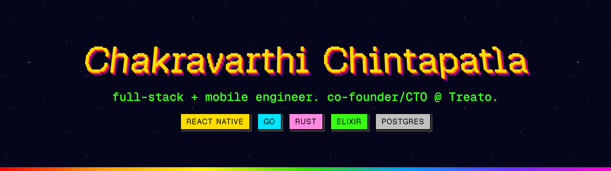
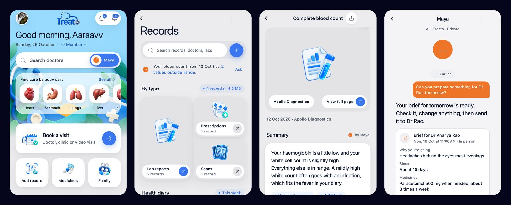

  <a href="https://vanitascaesar1.github.io"><b>Homepage</b></a> ·
  <a href="https://www.linkedin.com/in/chintapatla-chakravarthi">LinkedIn</a> ·
  <a href="mailto:chakravarthi8a2ss@gmail.com">Email</a> ·
  <a href="https://vanitascaesar1.github.io/resume.html">Resume</a>

Hi, I'm Chakravarthi. I build products end to end: mobile apps, web apps, the backend services behind them and the servers they run on.

I'm co-founder and CTO of **[Treato](https://treatoapp.com)**, a care platform for India where families, doctors and clinics share one health record. I'm its only engineer, with about 3,700 commits since March 2025. Almost all of it lives in private repos, so here it shows up as private contributions.

**Open to founding-engineer, React Native and full-stack roles, remote or relocating.**

## What I built at Treato

| Part | Stack | What it does |
| --- | --- | --- |
| Mobile | React Native, Expo | Patient and doctor apps: booking, family records, chat, LiveKit video visits |
| API | Go (Fiber), PostgreSQL | The core API: about 360 migrations, REST plus read-only GraphQL, RabbitMQ between services |
| Auth | Rust | Phone OTP and passkeys, one identity across patient, doctor and clinic roles |
| Real time | Elixir, Phoenix, LiveKit | Chat, and self-hosted video for consultations |
| AI | Claude | Maya explains reports in plain words, keeps a health diary and drafts visit briefs. It never diagnoses. |
| Web and desktop | Next.js, Tauri | The website with a public doctor directory, and a front-desk app for clinics |
| Infra | Docker, Dokploy, Linux | Self-hosted on a VPS with Elasticsearch and Dragonfly. I own deploys and backups. |

## Open source

**[expo-hot-toast](https://github.com/VanitasCaesar1/expo-hot-toast)**: the react-hot-toast API for Expo and React Native. Real Liquid Glass on iOS 26, Material 3 snackbars on Android, frosted glass on the web. [Try the demo](https://vanitascaesar1.github.io/expo-hot-toast/).

| Project | Language | What it does |
| --- | --- | --- |
| [ZVault](https://github.com/VanitasCaesar1/ZVault) | Rust | A secrets manager that keeps API keys away from AI coding tools. AES-256-GCM, installed from a Homebrew tap. |
| [ButterUI](https://github.com/VanitasCaesar1/ButterUI) | TypeScript | Smooth screen transitions and native portals for React Native, packaged as agent skills for Claude Code, Cursor and Codex. |
| [murkysql](https://github.com/VanitasCaesar1/murkysql) | Rust | Vector search inside SQLite, with HNSW and IVF indexes. |
| [Seer](https://github.com/VanitasCaesar1/seer) | Kotlin | A privacy-first Android keyboard. Suggestions stay on the device and it has no internet permission. |

## Toolbox

I work fast with AI coding agents and I own the parts they can't do: system design, product judgment and reviewing every line before it ships.

---

BCA, Adikavi Nannaya University (2025). Kakinada, India. Speaks English, Telugu, Hindi and Gujarati. Sign my guestbook at <a href="https://vanitascaesar1.github.io/#guestbook">vanitascaesar1.github.io</a>.
