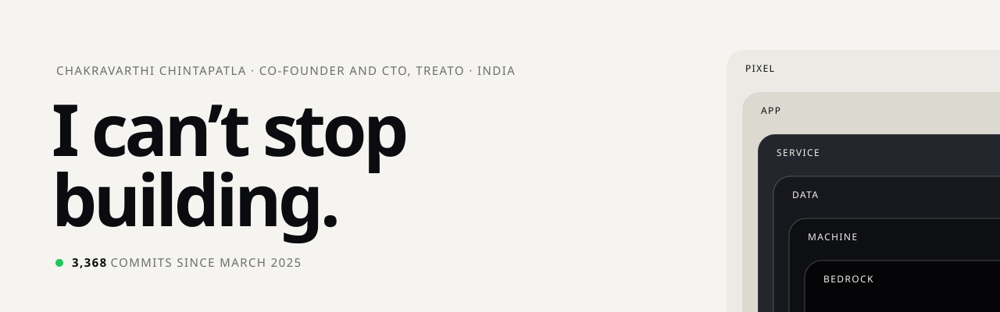

<a href="https://vanitascaesar1.github.io">
  <picture>
    <source media="(prefers-color-scheme: dark)" srcset="assets/banner-dark.svg">
    
  </picture>
</a>

  <a href="https://vanitascaesar1.github.io"><b>Homepage</b></a> ·
  <a href="https://vanitascaesar1.github.io/resume.html">Resume</a> ·
  <a href="https://www.linkedin.com/in/chintapatla-chakravarthi">LinkedIn</a> ·
  <a href="mailto:cto@treatoapp.com">cto@treatoapp.com</a>

I make unique, well-made things that people actually like, all the way down: from the pixel you touch to the machine underneath.

Right now that’s **[Treato](https://treato.cloud)**, where I’m co-founder and CTO: one health record for India’s families, doctors and clinics, with Maya, an assistant you just talk to. Five apps, live on the App Store and Play. We’re raising our first round.

Most of my code lives in private Treato repos, so here it shows up as private contributions.

## Things I made

| | |
|---|---|
| **[expo-hot-toast](https://github.com/VanitasCaesar1/expo-hot-toast)** · TypeScript | Toasts for Expo and React Native with the react-hot-toast API. Apple’s Liquid Glass on iOS 26, Material 3 on Android, frosted glass on the web. [Try the demo](https://vanitascaesar1.github.io/expo-hot-toast/) |
| **[ButterUI](https://github.com/VanitasCaesar1/ButterUI)** · TypeScript | Smooth screen transitions and native portals for React Native, packaged as agent skills for Claude Code, Cursor and Codex. |
| **[ZVault](https://github.com/VanitasCaesar1/ZVault)** · Rust | A secrets manager that keeps API keys away from AI coding tools. AES-256-GCM. `brew install VanitasCaesar1/tap/zvault` |

## Time machine

This profile, as it would have looked in 1997. [Visit the 1997 homepage too.](https://vanitascaesar1.github.io/1997/)

  
  
  
  

### Sign my guestbook

Open an issue titled **Guestbook: your message** and a GitHub Action writes you into this page within a minute. Links and formatting are stripped, so keep it to words.

<a href="https://github.com/VanitasCaesar1/VanitasCaesar1/issues/new?title=Guestbook%3A%20&body=Write%20your%20message%20in%20the%20title%20after%20%22Guestbook%3A%22.%20It%20shows%20up%20on%20my%20profile%2C%20so%20keep%20it%20friendly."><b>&gt;&gt; Sign the guestbook &lt;&lt;</b></a>

<!-- GUESTBOOK:START -->
_No signatures yet. Be the first!_
<!-- GUESTBOOK:END -->
