  <a href="https://vanitascaesar1.github.io"><b>Enter my homepage</b></a> ·
  <a href="https://vanitascaesar1.github.io/resume.html">Resume</a> ·
  <a href="https://www.linkedin.com/in/chintapatla-chakravarthi">LinkedIn</a> ·
  <a href="mailto:chakravarthi8a2ss@gmail.com">Email</a> ·
  <a href="#sign-my-guestbook">Sign my guestbook</a>

Hi! I'm Chakravarthi, from Kakinada, India. I build products end to end, from the Rust service that signs you in to the app in your hand. Almost everything I write lives in private Treato repos, so on this page it shows up as private contributions.

**Open to founding-engineer, React Native and full-stack roles**, remote or relocating.

## What I'm building

## Cool stuff I made

  
  
  
  
  
  

## Powered by

## Sign my guestbook

Open an issue titled **Guestbook: your message** and a GitHub Action writes you into this page within a minute. Links and formatting are stripped, so keep it to words.

<a href="https://github.com/VanitasCaesar1/VanitasCaesar1/issues/new?title=Guestbook%3A%20&body=Write%20your%20message%20in%20the%20title%20after%20%22Guestbook%3A%22.%20It%20shows%20up%20on%20my%20profile%2C%20so%20keep%20it%20friendly."><b>&gt;&gt; Sign the guestbook &lt;&lt;</b></a>

<!-- GUESTBOOK:START -->
_No signatures yet. Be the first!_
<!-- GUESTBOOK:END -->

---

&lt;&lt; <a href="https://vanitascaesar1.github.io">homepage</a> · <a href="https://www.linkedin.com/in/chintapatla-chakravarthi">linkedin</a> · <a href="https://vanitascaesar1.github.io/resume.html">resume</a> &gt;&gt; This profile will always be under construction.

